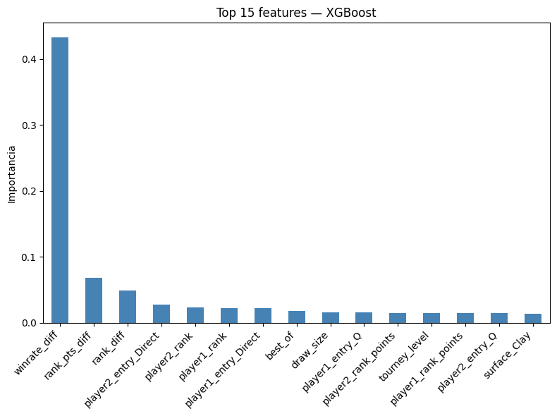
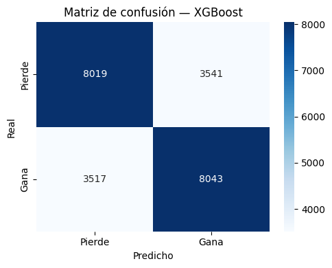

# ATP Match Outcome Prediction

Predicting the winner of ATP tennis matches **before they are played**, using 34 years of match data (1991–2024), a leakage-free form feature and a strict temporal train/test split.

**Best model: XGBoost — ROC-AUC 0.765 · accuracy 69.5 %** on 11,560 unseen matches from 2021–2024.

[](https://colab.research.google.com/github/AndresPastor1506/atp-match-prediction/blob/main/notebooks/ml_pipeline.ipynb)
&nbsp;Python · pandas · scikit-learn · XGBoost · ipywidgets

---

## Results

| Model | ROC-AUC (test) | Accuracy (test) | ROC-AUC (5-fold CV) |
|---|---|---|---|
| Logistic Regression | 0.761 | 69.1 % | — |
| Random Forest | 0.762 | 69.4 % | 0.769 |
| **XGBoost** | **0.765** | **69.5 %** | **0.773** |

Test set: every main-tour match from 2021-01-01 onwards (11,560 matches, 23,120 rows after symmetrisation). Training set: 1991–2020 (185,122 rows). CV and test scores are close, which suggests the models are not overfitting the training period.

<p align="center">
  
  
</p>

The recent-form feature (`winrate_diff`) carries most of the signal, well ahead of ranking points and ranking position.

## Approach

**1. Data.** 108k main-tour matches from [JeffSackmann/tennis_atp](https://github.com/JeffSackmann/tennis_atp), filtered to 1991–2024 and excluding qualifiers, challengers, futures and doubles. Height outliers and anomalous round codes are removed.

**2. Leakage-free form feature.** For each player, a *Bayesian win rate* over their previous 30 matches: `(wins + 5) / (matches + 10)`. The window is shifted by one match, so a match never sees its own result, and the prior keeps players with little history close to 0.5 instead of 0 or 1.

**3. Symmetrisation.** The raw data stores matches as *winner vs loser*, which would leak the label through column position. Each match is duplicated from both players' perspectives (`player1` / `player2`), giving a perfectly balanced target (50 % / 50 %).

**4. Difference features.** Ranking, ranking points, age, height, seed and win rate are expressed as `player1 − player2` differences, plus one-hot encoded surface, round, hand and entry type.

**5. Temporal split and tuning.** Train on 1991–2020, test on 2021–2024: the model only ever predicts the future. Random Forest (240 fits) and XGBoost (360 fits) are tuned with `GridSearchCV` on ROC-AUC.

## Interactive dashboard

`notebooks/dashboard.ipynb` is an `ipywidgets` + `matplotlib` dashboard over the full 1968–2024 dataset, with all logic in `src/viz_atp.py`:

- **Overview:** KPIs, matches by surface, top players by wins and aces, Grand Slam finals, biggest upsets filtered by ranking gap
- **Head to head:** overall record, split by surface, serve stats and full match history for any two players
- **Surface analysis:** per-surface cards, top-10 rankings and metric comparisons

## How to run

**Google Colab (recommended):** click the badge above. The first cell downloads the data automatically.

**Locally:**
```bash
git clone https://github.com/AndresPastor1506/atp-match-prediction
cd atp-match-prediction
pip install -r requirements.txt
jupyter notebook notebooks/
```
Run the cells in order. The grid searches take about 25–45 minutes on a standard CPU.

## Repository structure

```
├── notebooks/
│   ├── ml_pipeline.ipynb   # EDA, feature engineering, model training and evaluation
│   └── dashboard.ipynb     # Interactive exploration dashboard
├── src/
│   └── viz_atp.py          # Dashboard functions
├── images/                 # Figures used in this README
├── docs/
│   └── project_report_es.pdf  # Full project report (Spanish)
└── requirements.txt
```

Notebook comments and the report are in Spanish.

## Limitations and next steps

- No comparison yet against simple baselines such as "the higher-ranked player wins" or bookmaker odds, which would put the 69.5 % in context.
- Features do not include surface-specific form, fatigue (matches in recent days) or Elo ratings, all strong candidates for improving the model.

## Data and licence

Match data © Jeff Sackmann / Tennis Abstract, licensed under [CC BY-NC-SA 4.0](https://creativecommons.org/licenses/by-nc-sa/4.0/). The data is not redistributed here; it is downloaded at runtime.

---

Built by **Andrés Pastor López** as the final project of the Big Data module of the Master in Big Data, AI and Python (CEI, Madrid). [LinkedIn](https://www.linkedin.com/in/andr%C3%A9s-pastor-l%C3%B3pez-7047963b6/)
